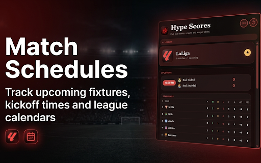

# Hype - Live Football Scores

Check live football scores, recent results, and upcoming matches without leaving
your tab.

**[Install from the Chrome Web Store](https://chromewebstore.google.com/detail/hype-live-football-scores/cdnpjnmhmagmiefkleefgchgffeaacaa)**

## Follow the matches that matter

- See what's live, what's coming up, and what just finished.
- Star your favorite leagues to keep them at the top.
- Open a league for kick-off times, results, and standings.
- Open a match for lineups, stats, and key moments when available.
- Choose a popup size and back up your favorites and size preference from Settings.

Follow the Premier League, LaLiga, the Champions League, and more in the same
popup.

## Get started

1. Install Hype from the Chrome Web Store.
2. Open Chrome's Extensions menu and pin Hype to your toolbar.
3. Click the Hype icon, then star any league you want to see first.

## Privacy and help

No account is needed. Favorites and display preferences stay in your browser.
For details about the limited usage data Hype collects, see the
[privacy notice](PRIVACY.md).

Have an idea or found a bug? [Open an issue](https://github.com/Atakan0zkan/Hype-LiveScore-Extension/issues).
For security concerns, see [how to report them privately](SECURITY.md).
For local setup and releases, see the [maintainer guide](docs/DEVELOPMENT.md).

## License

[PolyForm Strict License 1.0.0](LICENSE).
